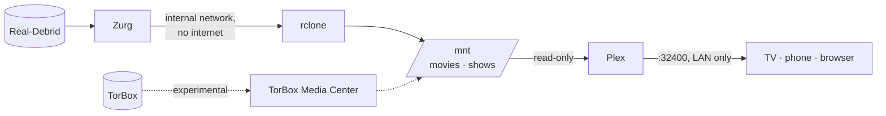

# debrid-plex-stack

Stream your Real-Debrid (or TorBox) library in Plex: isolated, LAN-only, one command to install.

> Designed and written by [Claude](https://claude.ai) (Anthropic) with [007games](https://github.com/007games).

## Install

```bash
curl -fsSL https://raw.githubusercontent.com/007games/debrid-plex-stack/main/install.sh | sudo bash
```

It asks which service you use, its API key ([Real-Debrid](https://real-debrid.com/apitoken) or [TorBox](https://torbox.app/settings)), and a [Plex claim code](https://plex.tv/claim). Then open `http://<server-ip>:32400/web`.

**Needs:** Linux or Synology DSM 7, Docker with Compose v2 (Synology: Container Manager), and a paid Real-Debrid or TorBox account.

**On Synology**, also create two tasks in DSM (see [Synology: boot and watchdog tasks](#synology-boot-and-watchdog-tasks)). Regular Linux gets systemd units automatically.

## Synology: boot and watchdog tasks

DSM doesn't support creating root tasks from the command line, so add these two once in **DSM → Control Panel → Task Scheduler**. Without them the stack won't come back properly after a reboot, the mount isn't healed, and management-page actions stay "pending".

1. **Create → Triggered Task → User-defined script**
   - *General:* name `debrid-boot`, user **root**, event **Boot-up**
   - *Task Settings:* `bash /volume1/@debrid/scripts/boot.sh`
2. **Create → Scheduled Task → User-defined script**
   - *General:* name `debrid-watchdog`, user **root**
   - *Schedule:* **daily**, first run **00:00**, frequency **every 1 minute**, last run **23:59**
   - *Task Settings:* `bash /volume1/@debrid/scripts/watchdog.sh`

DSM warns about running as root and asks for your password; confirm both. Installed somewhere else with `DEBRID_DIR`? Use that path instead of `/volume1/@debrid`.

**Check:** after a minute, *updated* on the management page changes every minute, or `sudo tail -3 /volume1/@debrid/logs/debrid.log` shows new entries.

## What you get



| | Real-Debrid (default) | TorBox (experimental) |
|---|---|---|
| Mount | Zurg + rclone | [TorBox Media Center](https://github.com/TorBox-App/torbox-media-center) (official) |
| Libraries | Movies, TV Shows, Anime | Movies, TV Shows |
| New titles appear | within ~15 min | after the mount refresh (default 2 h) |
| Isolation | mount container has no internet | mount container needs internet |

- **Isolated:** Plex can't reach the provider containers; it only reads the mount. Zurg listens on `127.0.0.1` only.
- **LAN-only:** Remote Access, Relay and UPnP are off, and a firewall rule limits port 32400 to your subnet. No `network_mode: host`.
- **Self-healing:** a watchdog (every minute) remounts and restarts the stack if the mount dies.
- **Plex pre-configured:** libraries are created. Thumbnails and intro/credit detection are off, because they would read every file from the cloud. Auto-empty-trash is off, so a dropped mount can't wipe your library. Hardware transcoding is used when `/dev/dri` exists (Plex Pass required).

Add content with your provider's website, or for Real-Debrid with e.g. [Debrid Media Manager](https://debridmediamanager.com).

**Switching provider later:** back up your library hashes (`python tools/rd.py backup` for Real-Debrid), run `uninstall.sh --purge`, re-run the installer and re-add the hashes at the new service.

## Management page (optional)

The installer offers a small web page at `https://<server-ip>:8099` (LAN only, password protected) to:
- check status,
- see your current key (masked; full key after re-entering the password) and change it (checked with the provider before it's saved),
- switch provider,
- restart the stack, pause the watchdog, and download library backups,
- change the page's own password,
- get a warning bar (and a daily log line) when premium has 7 days or less left; set `EXPIRY_WARN_DAYS` in `.env` to change that.

The browser will warn once about the self-signed certificate; that's expected.

The page has no Docker access and can't change the stack itself: it only queues requests, which a root script on the host (`scripts/agent.sh`) validates against a whitelist and applies within a minute (instantly on systemd). Set it up later, or reset a forgotten password, with `sudo bash scripts/admin-setup.sh`.

## Commands

```bash
sudo bash /opt/debrid/scripts/status.sh      # health check (Synology: /volume1/@debrid)
sudo bash /opt/debrid/uninstall.sh           # remove (add --purge to delete everything)
sudo bash /opt/debrid/scripts/set-key.sh realdebrid KEY   # change a key from the shell
curl -fsSL .../install.sh | sudo bash        # re-run to update; keeps your settings
python tools/rd.py status                    # Real-Debrid account helper (RD_TOKEN=...)
```

Options: `DEBRID_DIR=/path`, `PLEX_LANGUAGE=nl-NL`, `PROVIDER=torbox`, or `RD_TOKEN=...`/`TORBOX_API_KEY=...` plus `PLEX_CLAIM=...` for a non-interactive install. Run `install.sh --check` to see what would be detected.

## Notes

- **Turn off UPnP on your router.** The stack doesn't need it, and it lets any device on your network open ports.
- **Plex shows titles as unavailable:** the mount dropped. The watchdog fixes it within a few minutes, or run `scripts/boot.sh`.
- **Plex asks for a Plex Pass at home:** run `scripts/plex-setup.sh` again; your device is probably being treated as remote.
- **Stutter on 4K remuxes:** that's the client transcoding. Enable Direct Play in the Plex app, or use lighter releases.

You are responsible for what you stream. Use this only with content you have the right to access, and follow Real-Debrid's terms.

MIT licensed. Created by Claude (Anthropic) for 007games.
